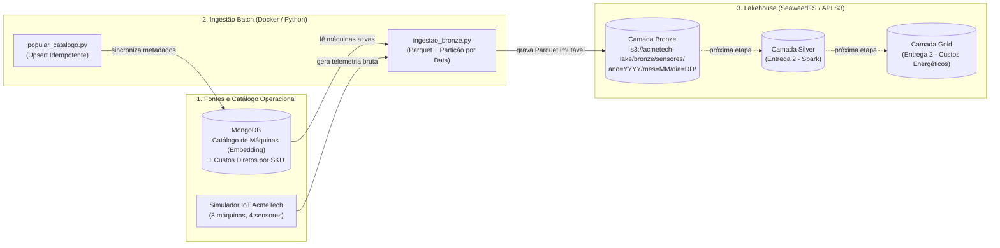

# Plataforma de Dados Industriais AcmeTech — Integração de Dados II

Protótipo de engenharia de dados para ingestão de telemetria IoT (3 máquinas, 4 sensores) e catálogo operacional, estruturado em arquitetura Lakehouse (`Bronze -> Silver -> Gold`) como base experimental para apoio à precificação B2B.

## Arquitetura da Fundação (Entrega 1)



### Componentes Implementados

* **MongoDB (`acmetech-mongodb`):** catálogo operacional de máquinas e sensores (padrão *embedding*) e cadastro sintético de custos diretos por SKU (`popular_catalogo.py`).
* **SeaweedFS (`acmetech-seaweedfs`):** armazenamento de objetos compatível com Amazon S3 (`s3://acmetech-lake`) para o *lakehouse*.
* **Pipeline de Ingestão (`acmetech-ingestao`):** simula leituras periódicas com ~5% de anomalias brutas preservadas e grava lotes **Parquet** particionados por data na camada **Bronze** (`ingestao_bronze.py`).
* **Observabilidade Local (`acmetech-mongo-express` e Filer UI):** interfaces web para inspeção visual das coleções do MongoDB e dos arquivos Parquet no SeaweedFS.

## Como Executar

1. Copie o arquivo de variáveis de ambiente:
   ```bash
   cp -n .env.example .env
   ```

2. Suba os serviços e execute a carga inicial:
   ```bash
   make subir
   ```

3. Acompanhe os logs e valide os arquivos gerados:
   ```bash
   make logs
   make testar
   make inspecionar
   ```

4. Para encerrar e remover volumes:
   ```bash
   make derrubar
   ```

## Interfaces Visuais (Navegador)

Com os containers em execução (`make subir`), acesse:
* **SeaweedFS Filer UI (buckets e arquivos Parquet):** http://localhost:8888
* **SeaweedFS Master UI (cluster e volumes):** http://localhost:9333
* **Mongo Express (coleções `maquinas` e `custos_sku`):** http://localhost:8081

## Documentação e Governança

* [ADR-001: Armazenamento Analítico em Lakehouse (SeaweedFS + Medalhão)](docs/adr/001-lakehouse-medalhao.md)
* [ADR-002: Catálogo Operacional e Custos Diretos em MongoDB](docs/adr/002-catalogo-nosql-mongodb.md)
* [Runbook Operacional](docs/runbook.md)
